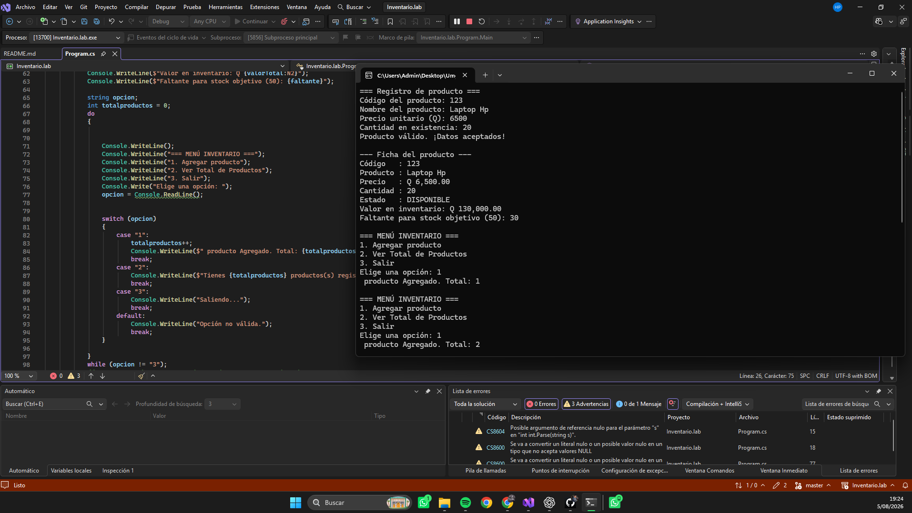
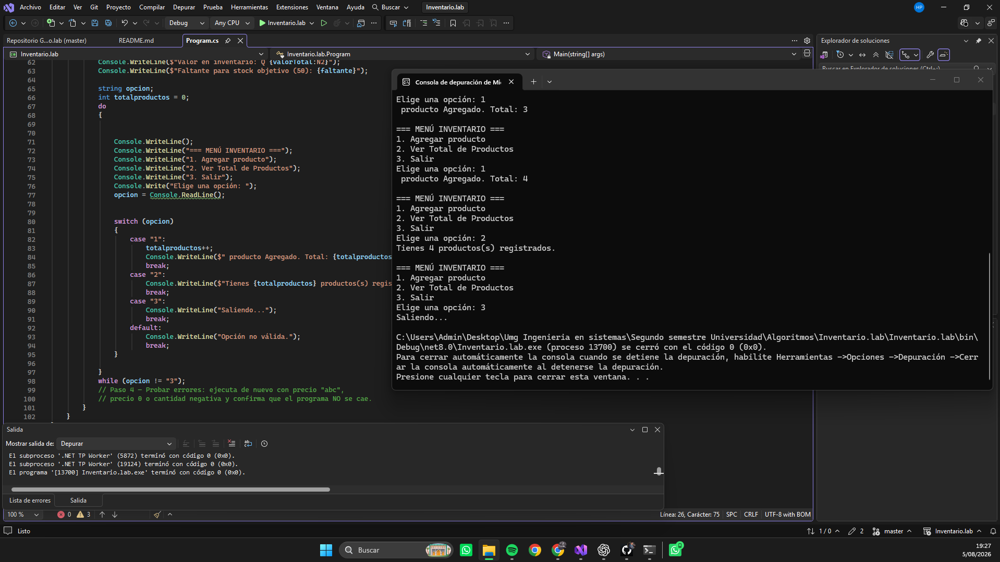

# Tarea 3 Registro de Productos
 Nota: No tengo las demas clases en las ramas porque el archivo me perdi y este es nuevo no el de el dia 1 

## Descripción

Programa desarrollado en C# que utiliza:

- TryParse
- if / else if / else
- switch
- while
- do...while

## Cómo ejecutar

- Abrir el proyecto en Visual Studio Community.
- Presionar **F5**.

O desde la terminal:

## Capturas

